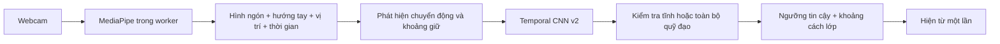

# Nối — ký hiệu tĩnh, ký hiệu động và nhận diện online

Nghiên cứu và thay đổi ngày 06/11/2026. Những nhận định về Nối dưới đây dựa trên code và kiểm thử phần mềm. Tốc độ, độ chính xác trên người dùng và lợi thế so với gõ bàn phím cần được đo trên dữ liệu ký hiệu thật.

**Lỗi trong bản trước**

App dùng video thu sẵn để học một nhãn cho cả clip, sau đó quét cửa sổ live 1–4 giây theo thời lượng quay. Một cửa sổ có tư thế đầu giống mẫu vẫn có thể đạt softmax cao. App hiện từ ngay sau một lượt dự đoán được chấp nhận. Chưa có kiểm tra đường đi đã hoàn tất, thời điểm kết thúc, hoặc khóa một ký hiệu đã phát. Điểm gần vùng dữ liệu dùng trung bình, độ lệch chuẩn và chênh đầu/cuối nên vòng tròn quay về điểm đầu dễ mất thông tin quan trọng.

Với ví dụ người dùng đưa ra, ký hiệu động phải chứa cả chỉ xuống, đi vòng và quay vào bản thân. Phần đầu có thể trùng với ký hiệu tĩnh “chúng ta”. Camera quan sát hai chuỗi giống nhau cho đến khi chúng tách ra. Suy luận kỹ thuật của dự án là quyết định đúng phải dựa vào phần tách ra hoặc quy ước giữ tay. Tăng kích thước mạng không cung cấp được các frame tương lai. Mốc giữ tĩnh 650 ms trong bản sửa là lựa chọn thiết kế có thể kiểm định, không phải hằng số ngôn ngữ học.

**Những cách đã được nghiên cứu**

| Công trình | Cách giải quyết | Áp dụng cho Nối |
| --- | --- | --- |
| Towards Online Continuous SLR, EMNLP 2024 | Từ điển clip ký hiệu, phân loại trên cửa sổ live, lớp nền cho chuyển tiếp, xử lý lặp | Cần khớp cách chuẩn bị dữ liệu train với đoạn được phân loại live, kiểm tra ranh giới và phát từ một lần. [Bài báo](https://aclanthology.org/2024.emnlp-main.619/) |
| TwoStream-SLR, NeurIPS 2022 | Kết hợp video RGB và chuỗi keypoint | RGB có thể bổ sung chi tiết tay mà keypoint bỏ lỡ. Cần đánh giá chi phí tính toán và dữ liệu của Nối trước khi thêm nhánh RGB. [Bài báo](https://papers.neurips.cc/paper_files/paper/2022/hash/6cd3ac24cdb789beeaa9f7145670fcae-Abstract-Conference.html) |
| SignBERT, ICCV 2021 | Biểu diễn bàn tay theo thời gian, thông tin tay trái/phải, tiền huấn luyện tự giám sát | Giữ thứ tự thời gian và danh tính từng tay. Tiền huấn luyện là hướng tiếp theo khi có tập lớn và đa dạng hơn. [Bài báo](https://openaccess.thecvf.com/content/ICCV2021/papers/Hu_SignBERT_Pre-Training_of_Hand-Model-Aware_Representation_for_Sign_Language_Recognition_ICCV_2021_paper.pdf) |
| SPOTER, WACV 2022 | Transformer trên pose, chuẩn hóa riêng không gian ký hiệu và tay | Chuẩn hóa hình ngón nhưng giữ vị trí và hướng tay ở nhánh khác. Việc xoay tay có thể đổi nghĩa trong Nối. [Bài báo](https://openaccess.thecvf.com/content/WACV2022W/HADCV/html/Bohacek_Sign_Pose-Based_Transformer_for_Word-Level_Sign_Language_Recognition_WACVW_2022_paper.html) |
| SHREC 2022 | Nhận dạng online 16 nhóm cử chỉ giữa các chuyển động ngoài nhãn | Đo thêm false positive và độ trễ. Benchmark dùng Hololens 2 nên không thể suy trực tiếp kết quả cho webcam RGB. [Bài báo](https://arxiv.org/abs/2207.06706) |
| Continual Graph Transformers, 2025 | Kết hợp đồ thị không gian với Transformer thời gian cho stream skeleton | Kiến trúc tham khảo khi chuyển sang giải mã liên tục. Benchmark SHREC’21 chưa xác nhận hiệu quả trên từ vựng Nối. [Bản nghiên cứu](https://arxiv.org/html/2502.14939v1) |

HaMeR và WiLoR cải thiện bài toán dựng hình bàn tay 3D từ ảnh. Việc tái tạo hình học là một phần của hệ thống. Nối còn cần học nghĩa của chuỗi và xác định lúc kết thúc. WiLoR có triển khai PyTorch/CUDA và cần MANO với điều kiện cấp phép riêng. Chưa có benchmark trong trình duyệt của dự án để chứng minh việc thay tracker sẽ giải quyết lỗi chốt từ sớm. Bản cập nhật tiếp tục dùng MediaPipe Lite/Full hiện có và sửa tầng giải mã thời gian. [HaMeR](https://openaccess.thecvf.com/content/CVPR2024/html/Pavlakos_Reconstructing_Hands_in_3D_with_Transformers_CVPR_2024_paper.html), [WiLoR và hướng dẫn triển khai](https://github.com/rolpotamias/WiLoR)

MediaPipe cung cấp landmark tay và xử lý chuỗi video. Tài liệu Web đề nghị dùng worker để tránh chặn giao diện khi chạy nhận diện đồng bộ. Nối đã chạy tracker trong worker, yêu cầu camera 60 fps nếu thiết bị hỗ trợ và xử lý frame mới nhất. Có thể chọn Full để thử chi tiết hình tay, nhưng tốc độ và tỷ lệ mất tay phải được đo trên máy thực tế. [Tài liệu MediaPipe](https://developers.google.com/edge/mediapipe/solutions/vision/hand_landmarker?tab=Web)

**Kiến trúc đã triển khai**

CNN v2 nhận 32 bước × 172 đặc trưng, có ba Conv1D kernel 5, pooling và phần dense giữ thứ tự. Với hai nhãn có 56.938 tham số. Bộ kiểm tra chuyển động lưu tối đa hai template nén cho mỗi lớp. Template giữ dịch chuyển cổ tay, orientation 6D và độ gập ngón của cả hai tay. Hình 21 điểm/ngón vẫn có trong đầu vào CNN. Đây là kiến trúc riêng của Nối lấy ý tưởng từ nghiên cứu, chưa tái hiện benchmark của các bài báo.

Huấn luyện tự cắt phần chờ bằng tiêu chí chuyển động. Nhãn Tĩnh chọn đoạn giữ ổn định, nhãn Động giữ chuỗi chuyển động. Có chế độ tự xác định, nhưng người thu nên chỉ định rõ các cặp dễ nhầm. Dữ liệu train được biến đổi nhịp thời gian 0,75×, 1× và 1,25×, giữ nguyên thứ tự và toàn bộ hành động. Dữ liệu validation được tách theo phiên hoặc nguyên clip trước khi tạo biến thể. Các ngưỡng và template đều lấy từ tập train.

Live chỉ phân loại khi có ứng viên đã đủ dữ liệu. Ký hiệu động chờ khoảng ổn định 180 ms. Ký hiệu tĩnh chờ 650 ms. Bộ giải mã kiểm tra đường đi bằng DTW có đầu và cuối đóng, lượng chuyển động tối thiểu và tư thế cuối. Vì vậy tư thế ban đầu hoặc nửa vòng không tự đáp ứng mẫu cả vòng. Hệ thống vẫn yêu cầu softmax ≥0,68, khoảng cách giữa hai ứng viên ≥0,18 và gần vùng đặc trưng của lớp. Các ngưỡng này cần hiệu chỉnh trên dữ liệu thật.

Một từ đã nhận được khóa cho đến khi tay thay đổi hoặc rời khung. Nếu tay tiếp tục chuyển động trong lúc dự đoán đang tính, kết quả cũ bị hủy. Tay mất tracking hoặc khoảng frame gián đoạn trên 250 ms làm bắt đầu lại đoạn, tránh nối hai quỹ đạo không quan sát được. Sau chuyển động bị từ chối, giữ tư thế ổn định 650 ms cho phép bắt đầu một từ tĩnh mới. Đây cũng là giới hạn của cặp có tiền tố trùng nhau. Nếu người dùng dừng đủ lâu giữa ký hiệu động, hệ thống có thể hiểu đó là từ tĩnh.

Buffer giới hạn 5 giây. Một clip quá dài bị khóa đến lần chuyển động kế tiếp. Các ký hiệu động nối liên tục không có khoảng ổn định, chuyển động cực nhỏ dưới ngưỡng, và ký hiệu dùng vị trí tương đối với thân vẫn là giới hạn. Để giải quyết nối từ tự nhiên cần dữ liệu chuỗi có ranh giới và bộ giải mã được huấn luyện, chẳng hạn causal TCN/CTC hoặc streaming Transformer. CTC có nhãn blank giúp căn chỉnh chuỗi nhưng cần dữ liệu và cách đánh giá phù hợp. Thay loss đơn lẻ chưa tạo được mô hình tốt cho dữ liệu hiện có.

**Dữ liệu cần thu cho cặp “chúng ta / chúng tôi”**

Trong Thu mẫu, đặt “chúng ta” thành Tĩnh và “chúng tôi” thành Động rồi huấn luyện lại. Quay một lần ký hiệu đầy đủ trong mỗi video, với một khoảng ngắn trước và sau. Động tác đi vòng phải được nhìn thấy từ đầu tới lúc quay vào bản thân. Các mẫu cũ vẫn dùng được nếu đã ghi đầy đủ. Model cũ cần train lại để có CNN v2 và template chuyển động, sau đó có thể xuất ZIP để chạy local.

30 clip mỗi nhãn là ngân sách thu thập ban đầu. Đề xuất chia thành ba phiên, mỗi phiên có tốc độ chậm/vừa/nhanh, thay vị trí bắt đầu và ánh sáng. Nếu mục tiêu dùng chung, cần nhiều người ký hiệu và tập test giữ nguyên người ngoài train. Thêm mẫu NO_SIGN gồm cử động nghỉ, chỉnh áo, chuyển giữa các tư thế. Các tiền tố thực sự có nghĩa tĩnh cần giữ nhãn tĩnh tương ứng, tránh gán mọi tiền tố thành nền. Thu riêng nửa vòng, vòng ngược và dừng giữa vòng để đánh giá khả năng từ chối, chỉ dùng làm train khi đã xác định nhãn đúng.

**Đo “nhanh hơn đánh máy”**

Google công bố tập fingerspelling ASL có tốc độ trung bình 57 từ/phút, so với mức 36 từ/phút của bàn phím trên màn hình được bài viết dẫn. Đây là số liệu về tác vụ và người ký hiệu trong nghiên cứu. Dự án cần so sánh Nối với chính tốc độ gõ máy tính của người dùng trên cùng nội dung, tính cả sửa lỗi, thời gian chốt và thao tác thêm từ. [Google TensorFlow Blog](https://blog.tensorflow.org/2023/05/american-sign-language-fingerspelling-recognition.html)

Tách độ trễ thành thu hình, tracker, chờ phân biệt/kết thúc, classifier và cập nhật chữ. 180/650 ms là khoảng chờ cấu hình, chưa gồm toàn bộ pipeline. Đo p50/p95 từ frame cuối có nghĩa đến lúc hiện đúng từ, cùng tỷ lệ từ sai, bỏ sót, chốt sớm và số lần hiện lặp. Đánh giá độ chính xác cân bằng từng lớp, confusion matrix cho các cặp tĩnh/động, false positive/phút trên cử động nền, WER trên chuỗi liên tục và số từ đúng/phút sau chỉnh sửa. Không dùng softmax làm phần trăm đúng thực tế.

Mốc kỹ thuật đề xuất để thử nghiệm là p95 classifier dưới 50 ms trên máy đích, không chốt sớm ở bộ tiền tố đã định nghĩa, và đo tỷ lệ đúng trên phiên/người chưa thấy. Chỉ coi tốc độ vượt gõ phím khi số từ đúng/phút sau chỉnh sửa cao hơn baseline cá nhân. Nếu vẫn cần nhấn dấu cộng để ghép từ, thời gian thao tác đó phải nằm trong phép đo.

Các bài kiểm thử `tests/unit/motion.test.ts` và `qa/motion-recognition.mjs` kiểm tra hình học tổng hợp, model TFJS thật, tốc độ thay đổi, tiền tố, nửa vòng, hướng vòng ngược, chống phát lặp và xuất/nhập. Kết quả đo được ghi trong `QA.md`. Cần thêm video thật của cặp ký hiệu người dùng để kết luận độ chính xác ngôn ngữ. Toàn bộ thay đổi chạy trên thiết bị, sử dụng hạ tầng miễn phí hiện có.
